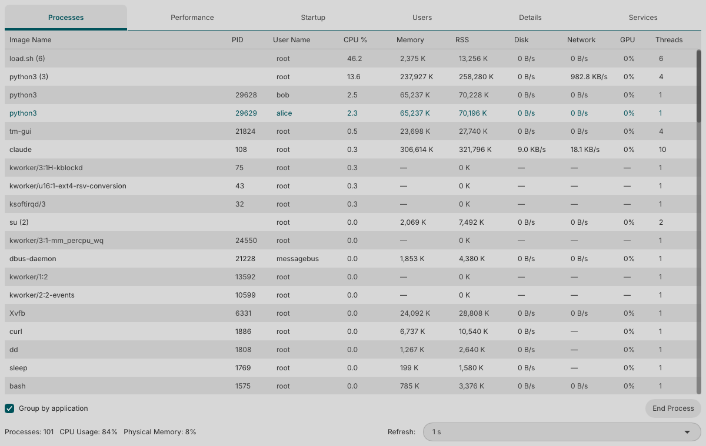
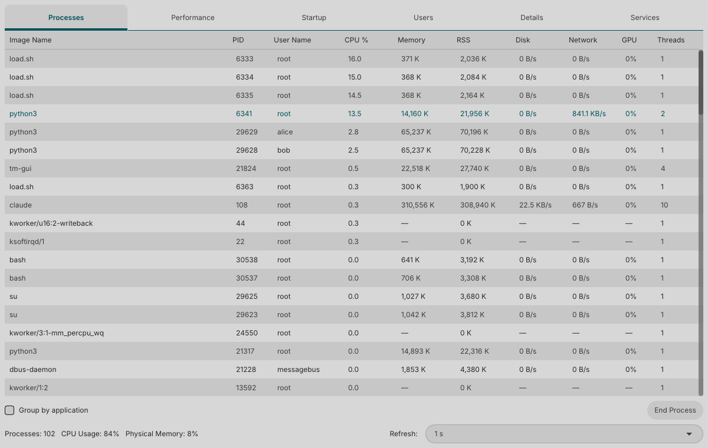
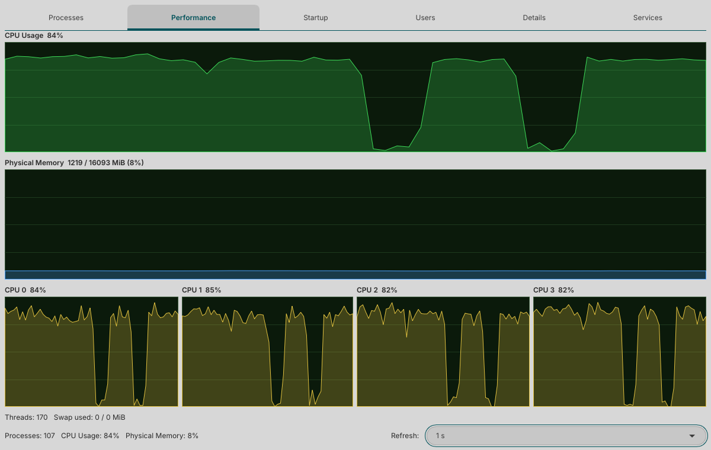
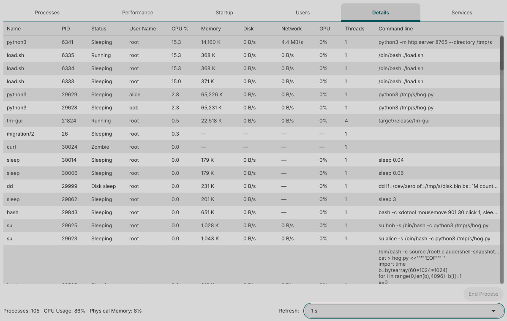
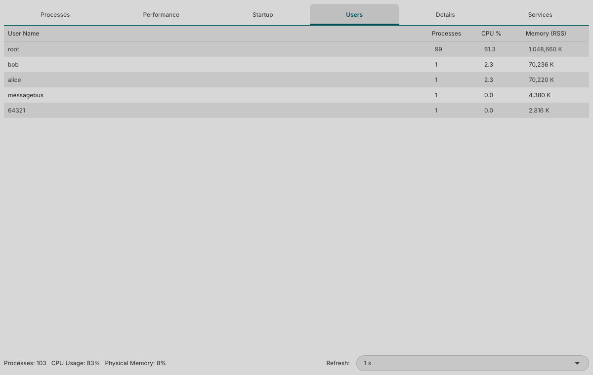
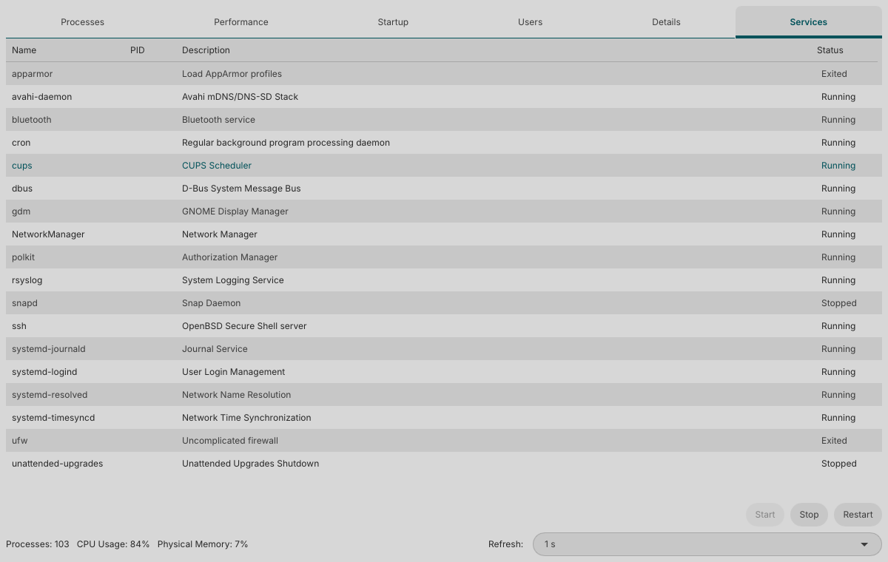
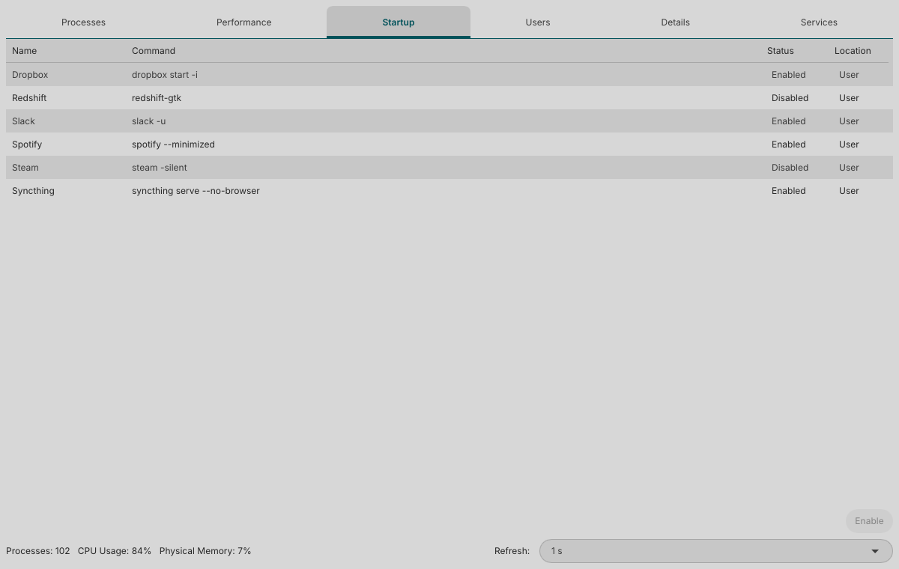
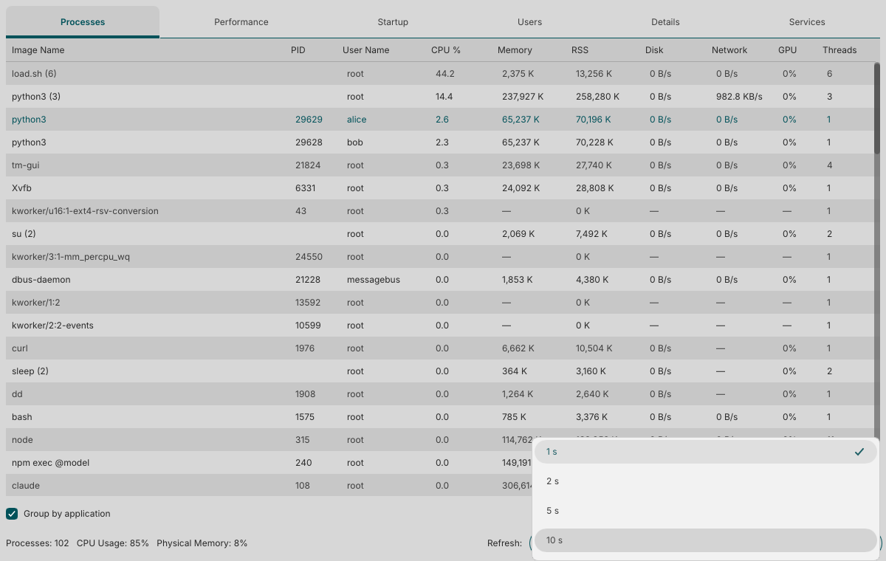

# Task Manager

A zero-bloat Task Manager for Linux, modelled on the one Windows shipped before Windows 11. It aims for the **speed and simplicity of Windows 7** and the **information density of Windows 10**: a small native window, a handful of tabs, and nothing that runs when you are not looking at it.

It is written in Rust, draws its UI with [Slint](https://slint.dev), reads `/proc` directly, and never runs as root.



## Install

These steps are for Ubuntu, Linux Mint, Debian and other distributions that use `.deb` files. You do not need the terminal.

### 1. Download

Open the [Releases page](https://github.com/chz160/task-manager/releases/latest) and download the file ending in `.deb` (for example `task-manager_0.1.0-1_amd64.deb`). Your browser saves it to the Downloads folder.

<!-- TODO screenshot: docs/screenshots/install-1-download.png (Releases page with the .deb file highlighted) -->
*Screenshot to be added: the Releases page with the `.deb` file highlighted.*

### 2. Install

Open your Downloads folder and double-click the `.deb` file. The Software Installer opens. Click **Install** and type your password when asked.

<!-- TODO screenshot: docs/screenshots/install-2-installer.png (Software Installer showing Task Manager) -->
*Screenshot to be added: the Software Installer with the Install button.*

### 3. Open it

Open the menu (the button at the bottom left, like the Windows Start button), type **Task Manager**, and click it. It is also under the **System** category.

<!-- TODO screenshot: docs/screenshots/install-3-menu.png (application menu showing Task Manager) -->
*Screenshot to be added: the menu with Task Manager found.*

### 4. Set Ctrl+Shift+Esc (optional)

On Windows, Ctrl+Shift+Esc opens Task Manager. Linux does not set that up for you, because each desktop keeps its own shortcut settings. Follow the steps for your desktop. If you are not sure which one you have, Linux Mint is usually Cinnamon, Ubuntu is GNOME, and Kubuntu is KDE.

#### Cinnamon (Linux Mint)

1. Open the menu, type **Keyboard** and open **Keyboard** settings.
2. Click the **Shortcuts** tab, then **Custom Shortcuts** in the list on the left.
3. Click **Add custom shortcut**. For the name type `Task Manager`, for the command type `tm-gui`, then click **Add**.
4. Click the empty space under **Keyboard bindings** next to your new shortcut, press **Ctrl+Shift+Esc**, and close the window.

<!-- TODO screenshot: docs/screenshots/shortcut-cinnamon.png -->
*Screenshot to be added: Cinnamon custom shortcut.*

#### GNOME (Ubuntu)

1. Open **Settings**, then **Keyboard**.
2. Scroll down to **View and Customize Shortcuts**, then click **Custom Shortcuts**.
3. Click **Add Shortcut** (the **+** button). For the name type `Task Manager` and for the command type `tm-gui`.
4. Click **Set Shortcut...**, press **Ctrl+Shift+Esc**, then click **Add**.

<!-- TODO screenshot: docs/screenshots/shortcut-gnome.png -->
*Screenshot to be added: GNOME custom shortcut.*

#### KDE Plasma (Kubuntu, KDE neon)

KDE may already have picked up Ctrl+Shift+Esc from the installed menu entry, so try pressing it first. If nothing opens:

1. Open **System Settings**, then **Keyboard** (or **Shortcuts**), then **Shortcuts**.
2. Find **Task Manager** in the list, or use the search box.
3. Click the shortcut button next to it, press **Ctrl+Shift+Esc**, then click **Apply**.

<!-- TODO screenshot: docs/screenshots/shortcut-kde.png -->
*Screenshot to be added: KDE shortcut settings.*

If the shortcut is already taken by another program, your desktop will tell you which one. Pick another combination or remove the old one.

### Updating and removing

Download the newer `.deb` and double-click it again: the installer offers **Reinstall** or **Upgrade**. To remove it, open the Software Manager, find Task Manager and click **Remove**.

### Install from the terminal (advanced)

```
sudo apt install ./task-manager_0.1.0-1_amd64.deb
```

Use the real file name you downloaded. `apt` installs the libraries it needs. Every release also has a `.tar.gz` (the same files under the same paths, for distributions without `apt`; it needs glibc 2.35 or newer) and a `SHA256SUMS` file. To check a download:

```
sha256sum -c SHA256SUMS --ignore-missing
gh attestation verify task-manager_0.1.0-1_amd64.deb --repo chz160/task-manager
```

The rolling [`nightly` prerelease](https://github.com/chz160/task-manager/releases/tag/nightly) holds a build of the latest `main` for anyone who wants to try changes early.

## Features

### Processes

The familiar process table, with the columns you would expect and a few Windows 10 additions.

- **Group by application** (on by default): processes are folded into the application that launched them, such as a browser and all its helpers, named from the cgroup the desktop session put them in (systemd `app-*.scope`, Flatpak, Snap and services). Untick it for a flat list.
- **Columns**: image name, PID, user, CPU %, **Memory** (PSS, which splits shared pages between the processes using them, so totals add up), RSS, **Disk** (read plus write rate), **Network**, **GPU** and threads.
- Click a header to sort. The selection follows a process as the rows re-sort.
- **End Process** asks for confirmation first. On a group it ends every process in it.
- The **Network** column is each process's TCP receive plus send rate. It needs no root and no setup (the kernel's `sock_diag` interface plus `/proc/<pid>/fd`), but it only sees your own processes (all of them if you run as root), and UDP is not counted. Anything it cannot read shows "—".



### Performance



A CPU history graph, a physical memory graph, and one small graph per CPU core, each covering the last 60 samples, with thread count and swap use underneath. With the NVIDIA proprietary driver there is also one graph per GPU (see [NVIDIA GPUs](#nvidia-gpus)).

### Details



The flat, ungrouped table in the style of the Windows 10 Details tab: every process on its own row with its state (Running, Sleeping, Idle, Disk sleep, Zombie), user, CPU, memory, disk, network, GPU, threads and full command line. It has its own End Process button.

### Users



Process count, CPU and memory (RSS) totals per user. This is a resource summary, not a list of login sessions. User names come from `/etc/passwd`; unknown IDs are shown as numbers.

### Services



The system's systemd services, read over D-Bus (no privileges needed) with name, main PID, description and status. Select one and use **Start**, **Stop** or **Restart**. These run `pkexec systemctl`, so polkit shows its normal authentication dialog and the GUI itself stays unprivileged.

### Startup



Programs that start with your desktop session, from the XDG autostart directories (`~/.config/autostart` and `$XDG_CONFIG_DIRS`, usually `/etc/xdg/autostart`). Entries meant for other desktops are left out. Select one and use **Enable** or **Disable**: that writes an override into your own autostart directory, so system files are never touched and no root is needed.

### Refresh rate

The refresh selector at the bottom right sets how often everything updates: **1 s** (the default), **2 s**, **5 s** or **10 s**. A slower rate means less CPU.



### NVIDIA GPUs

I could not capture this one, as the machine used for the screenshots has no NVIDIA card. With the NVIDIA proprietary driver installed, the Performance tab gets one graph per GPU (name, load, memory, temperature) and the GPU column fills in per process. NVML (`libnvidia-ml.so.1`, shipped with the driver) is loaded with `dlopen` at runtime, so nothing is linked and no root is needed. Without an NVIDIA driver nothing extra is shown. Intel, AMD and other DRM drivers feed the per-process GPU column through the kernel's DRM fdinfo interface.

## Low overhead

A task manager that slows the machine down defeats its own purpose. This one reads only what it needs, and re-reads the expensive items (PSS, disk I/O, GPU, network) every 5 seconds instead of every refresh. CPU use is about **1.5% of one core at the default 1 s refresh** with roughly 1,000 processes running. CI enforces a budget of 2%: `scripts/perf-check.sh target/release/tm-gui` starts Xvfb and about 1,000 processes, runs the release binary and fails if it uses 2% or more of one core.

Most of that is the unavoidable cost of reading `/proc/<pid>/stat` for every process, which the script prints as a floor. Pick a slower refresh and it drops further.

## Build and run

You need a Rust toolchain ([rustup](https://rustup.rs)) and, on Debian or Ubuntu:

```
sudo apt install libfontconfig1-dev libxkbcommon-x11-0
cargo run --release -p tm-gui
```

`libfontconfig1-dev` is needed to build. At run time the program also loads the X11, Wayland and xkbcommon libraries (`libx11-6`, `libx11-xcb1`, `libxcursor1`, `libxi6`, `libxkbcommon0`, `libxkbcommon-x11-0`, `libwayland-client0`), which any desktop install already has; the `.deb` lists them as dependencies. The Services tab needs systemd.

There is also `tm-cli`, a top-style table that prints the same data and is handy for checking the sampler:

```
cargo run --release -p tm-cli -- [interval_secs] [rows]
```

### Ending other users' processes (polkit policy)

The GUI sends SIGTERM itself. If that is refused with "permission denied" it runs `pkexec /usr/bin/kill -TERM -- <pid>`, and polkit asks for your password every time. The `.deb` installs a policy file that gives that prompt a clear text. If you built from source or use the tarball, install it by hand:

```
sudo install -m 644 packaging/org.taskmanager.end-process.policy /usr/share/polkit-1/actions/
```

Without it, pkexec still works with polkit's generic prompt. The policy covers `/usr/bin/kill` as a whole, as `sudo kill` would.

## Layout

| Crate | What it is |
| --- | --- |
| `crates/tm-core` | The stateful `/proc` sampler and the readers for network, GPU, services and startup entries |
| `crates/tm-gui` | The Slint application |
| `crates/tm-cli` | The top-style command-line table |
| `packaging/` | The polkit policy, `.desktop` file and icon shipped in the `.deb` |

## License

MIT, see [LICENSE](LICENSE). Slint is used under its royalty-free license terms.
