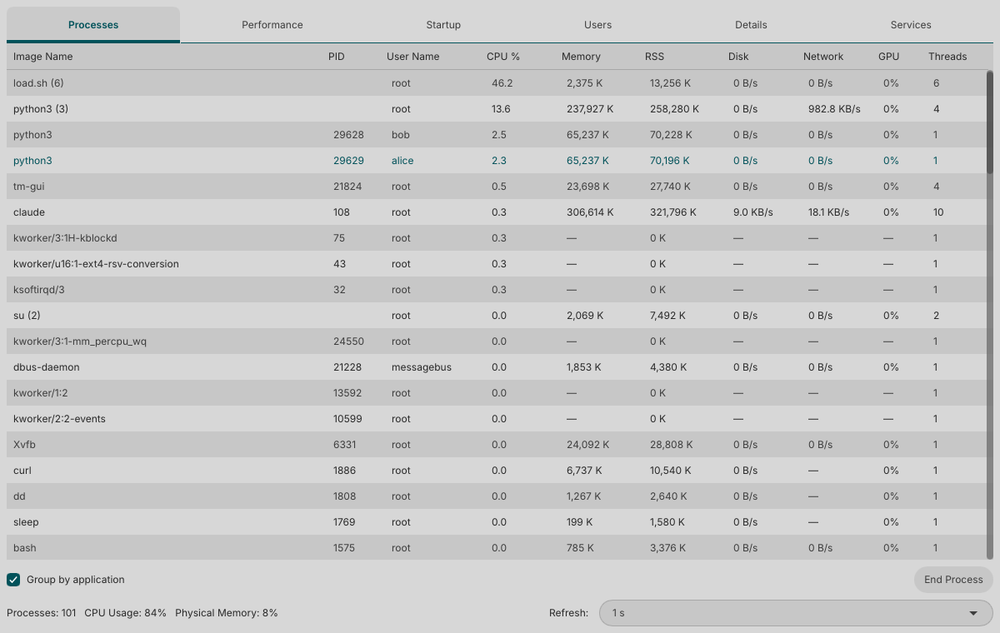
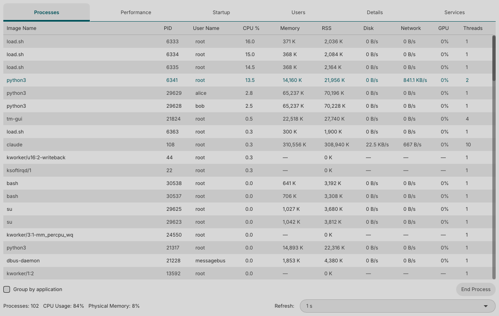
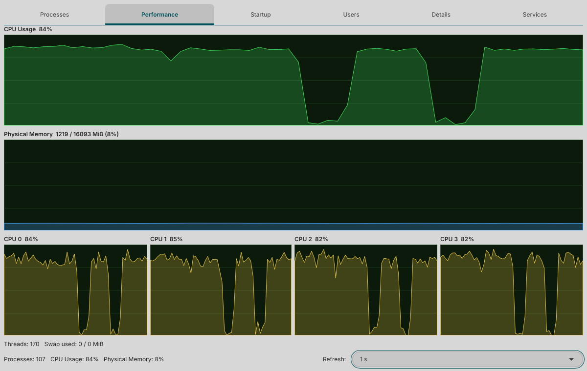
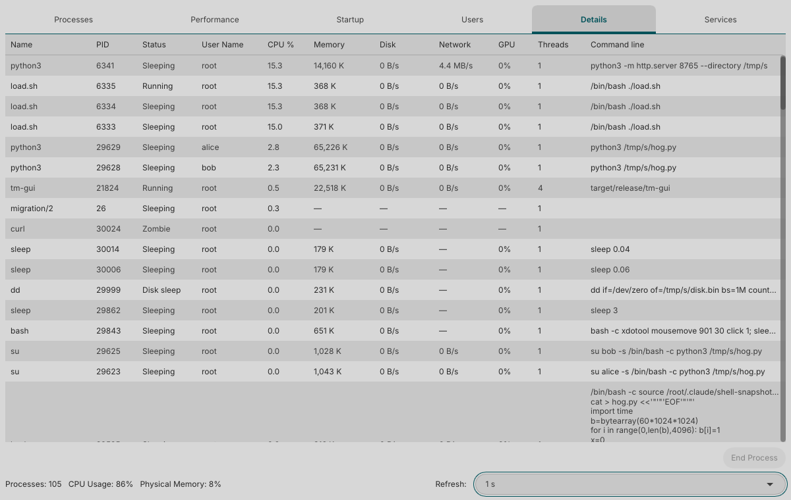
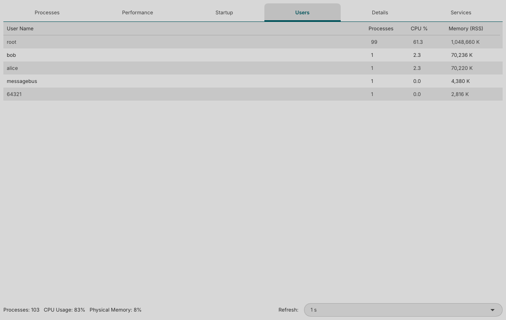
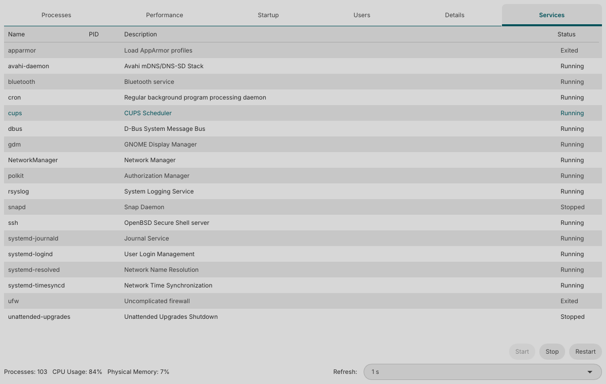
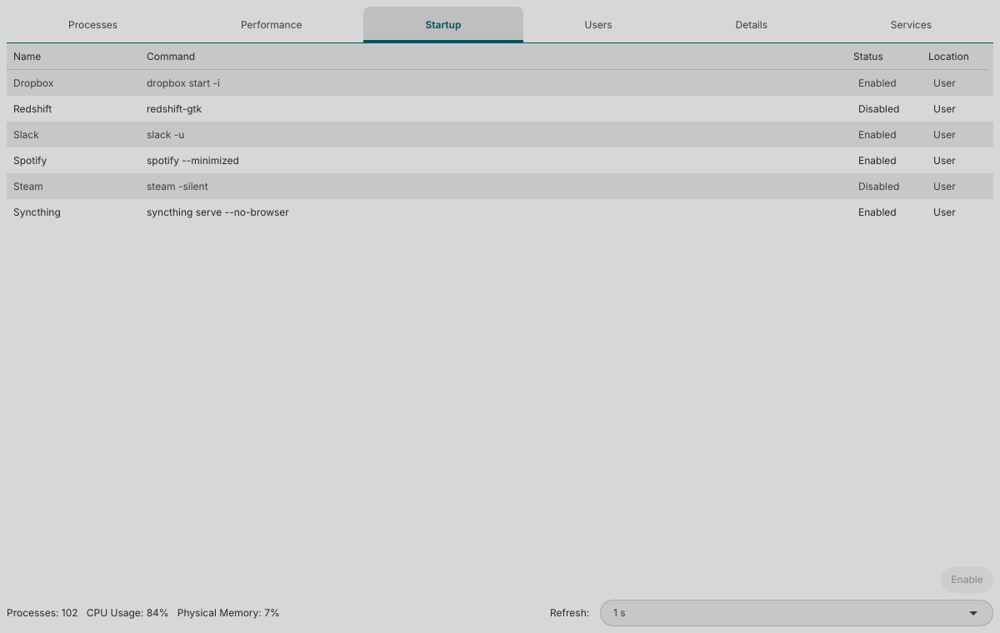
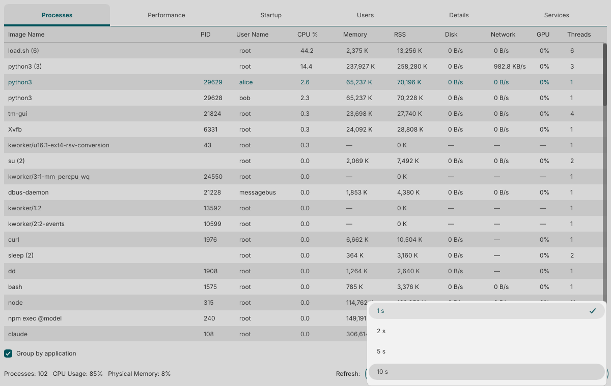

# Task Manager

A zero-bloat Task Manager for Linux, modelled on the one Windows shipped before Windows 11. It aims for the **speed and simplicity of Windows 7** and the **information density of Windows 10**: a small native window, a handful of tabs, and nothing that runs when you are not looking at it.

It is written in Rust, draws its UI with [Slint](https://slint.dev), reads `/proc` directly, and never runs as root.



## Features

### Processes

The familiar process table, with the columns you would expect and a few Windows 10 additions.

- **Group by application** (on by default): processes are folded into the application that launched them, such as a browser and all its helpers, named from the cgroup the desktop session put them in (systemd `app-*.scope`, Flatpak, Snap and services). Untick it for a flat list.
- **Columns**: image name, PID, user, CPU %, **Memory** (PSS, which splits shared pages between the processes using them, so totals add up), RSS, **Disk** (read plus write rate), **Network**, **GPU** and threads.
- Click a header to sort. The selection follows a process as the rows re-sort.
- **End Process** asks for confirmation first. On a group it ends every process in it.
- The **Network** column is each process's TCP receive plus send rate. It needs no root and no setup (the kernel's `sock_diag` interface plus `/proc/<pid>/fd`), but it only sees your own processes (all of them if you run as root), and UDP is not counted. Anything it cannot read shows "—".



### Performance



A CPU history graph, a physical memory graph, and one small graph per CPU core, each covering the last 60 samples, with thread count and swap use underneath. With the NVIDIA proprietary driver there is also one graph per GPU (see [NVIDIA GPUs](#nvidia-gpus)).

### Details



The flat, ungrouped table in the style of the Windows 10 Details tab: every process on its own row with its state (Running, Sleeping, Idle, Disk sleep, Zombie), user, CPU, memory, disk, network, GPU, threads and full command line. It has its own End Process button.

### Users



Process count, CPU and memory (RSS) totals per user. This is a resource summary, not a list of login sessions. User names come from `/etc/passwd`; unknown IDs are shown as numbers.

### Services



The system's systemd services, read over D-Bus (no privileges needed) with name, main PID, description and status. Select one and use **Start**, **Stop** or **Restart**. These run `pkexec systemctl`, so polkit shows its normal authentication dialog and the GUI itself stays unprivileged.

### Startup



Programs that start with your desktop session, from the XDG autostart directories (`~/.config/autostart` and `$XDG_CONFIG_DIRS`, usually `/etc/xdg/autostart`). Entries meant for other desktops are left out. Select one and use **Enable** or **Disable**: that writes an override into your own autostart directory, so system files are never touched and no root is needed.

### Refresh rate

The refresh selector at the bottom right sets how often everything updates: **1 s** (the default), **2 s**, **5 s** or **10 s**. A slower rate means less CPU.



### NVIDIA GPUs

I could not capture this one, as the machine used for the screenshots has no NVIDIA card. With the NVIDIA proprietary driver installed, the Performance tab gets one graph per GPU (name, load, memory, temperature) and the GPU column fills in per process. NVML (`libnvidia-ml.so.1`, shipped with the driver) is loaded with `dlopen` at runtime, so nothing is linked and no root is needed. Without an NVIDIA driver nothing extra is shown. Intel, AMD and other DRM drivers feed the per-process GPU column through the kernel's DRM fdinfo interface.

## Low overhead

A task manager that slows the machine down defeats its own purpose. This one reads only what it needs, and re-reads the expensive items (PSS, disk I/O, GPU, network) every 5 seconds instead of every refresh. CPU use is about **1.5% of one core at the default 1 s refresh** with roughly 1,000 processes running. CI enforces a budget of 2%: `scripts/perf-check.sh target/release/tm-gui` starts Xvfb and about 1,000 processes, runs the release binary and fails if it uses 2% or more of one core.

Most of that is the unavoidable cost of reading `/proc/<pid>/stat` for every process, which the script prints as a floor. Pick a slower refresh and it drops further.

## Build and run

You need a Rust toolchain ([rustup](https://rustup.rs)) and, on Debian or Ubuntu:

```
sudo apt install libfontconfig1-dev libxkbcommon-x11-0
cargo run --release -p tm-gui
```

`libfontconfig1-dev` is needed to build; `libxkbcommon-x11-0` is needed at run time on X11 (Wayland sessions do not need it). The Services tab needs systemd.

There is also `tm-cli`, a top-style table that prints the same data and is handy for checking the sampler:

```
cargo run --release -p tm-cli -- [interval_secs] [rows]
```

### Ending other users' processes (optional polkit policy)

The GUI sends SIGTERM itself. If that is refused with "permission denied" it runs `pkexec /usr/bin/kill -TERM -- <pid>`, and polkit asks for authentication. To get a clear prompt text, install the policy file:

```
sudo install -m 644 packaging/org.taskmanager.end-process.policy /usr/share/polkit-1/actions/
```

Without it, pkexec still works with polkit's generic prompt. The policy covers `/usr/bin/kill` as a whole, as `sudo kill` would.

## Layout

| Crate | What it is |
| --- | --- |
| `crates/tm-core` | The stateful `/proc` sampler and the readers for network, GPU, services and startup entries |
| `crates/tm-gui` | The Slint application |
| `crates/tm-cli` | The top-style command-line table |

## License

MIT, see [LICENSE](LICENSE). Slint is used under its royalty-free license terms.
